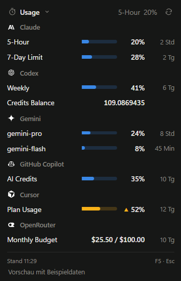

# Usage Bar

A small Windows tray app for usage limits across Claude, Codex, Gemini, GitHub Copilot, Cursor, and OpenRouter. Its compact view follows OpenChamber's Usage section.



The screenshot uses clearly labeled sample data.

- Hourly and weekly limits, reset times, and Codex credits in one compact view.
- Automatic updates every 3 minutes and manual refresh.
- Light or dark tray icon to match the taskbar, with a dark context menu.
- Provider selection, used or remaining quota display, and optional startup with Windows.
- Individual provider checkboxes; only enabled services are polled in the background.
- Setup window and Windows-encrypted storage for manually entered tokens.

## Supported providers

| Provider | Usage shown | Authentication |
| --- | --- | --- |
| Claude | Hourly and weekly limits, including reset times | Claude Code OAuth sign-in with profile permission; environment token or OpenCode OAuth as fallbacks |
| Codex | Subscription usage limits, reset times, and credit balance | Existing Codex sign-in or OpenCode OAuth; an OpenAI API key alone is not sufficient |
| Gemini | Model quotas and reset times | Gemini CLI Google sign-in or OpenCode OAuth; a Gemini API key alone is not sufficient |
| GitHub Copilot | AI credit usage and reset date | GitHub CLI account selection, local Copilot or OpenCode sign-in, environment token, or manually saved token with Copilot usage access |
| Cursor | Plan usage or spending, Auto/API breakdown, and on-demand quota where available | Explicit import of the Cursor desktop sign-in, environment token, or manually saved access token |
| OpenRouter | API-key budget and usage, or monthly spending for keys without a budget | Regular API key saved in the app, `OPENROUTER_API_KEY`, or OpenCode sign-in |

Each provider can be enabled independently under "Provider einrichten…" (Set up providers). Only enabled providers are polled. See [Authentication and data](#authentication-and-data) for setup instructions and account restrictions.

Release **v1.1.0** supports all six providers listed above. Release **v1.0.0** supports Claude and Codex only.

## Download

Get the Windows installer or portable ZIP from [Releases](https://github.com/Auda29/usage-bar/releases/latest).

**Installer:** Download `Usage-Bar-v<version>-windows-x64-Setup.exe` and run it. Setup installs the app for your Windows user without administrator rights, adds a Start menu entry, and starts Usage Bar. Uninstall it through Windows Settings under Apps. Installing an update or uninstalling the app preserves settings and saved provider credentials in `%APPDATA%/usage-bar/`.

**Portable ZIP:**

1. Download the Windows x64 ZIP for the version you want.
2. Extract the entire ZIP to a permanent folder.
3. Run `Usage Bar.exe` from that folder.

Requires Windows 10 or 11 on an x64 processor and a suitable sign-in or API key for at least one supported provider. Node.js and OpenChamber are not required to run the download. The files next to the EXE are part of the application and must stay in the folder. See each release's changelog for its supported providers.

## Using the app

The `Usage Bar.lnk` shortcut in the project folder launches the built app. After `npm run build`, the application is located at `dist/Usage Bar-win32-x64/Usage Bar.exe`. The entire folder is required and can be copied to a permanent location. Node.js and OpenChamber are not required to run the built app.

The interface currently uses German labels; their English meanings are included below.

- Left-click the bar icon next to the clock to open the usage view.
- Click "Usage" to collapse or expand the list.
- Click the refresh button or press F5 to update the values. Updates also run automatically every 3 minutes.
- Press Escape, click outside the window, or click the tray icon again to close the view.
- Right-click to open the menu with provider selection, used/remaining display, header status, and optional startup with Windows.
- Under "Design", pick one of seven looks: Kompakt (compact, the default), Fluent, Kacheln (tiles), Terminal, Fokus, Hell (light) and Klassisch (Legacy). Klassisch is the original look from versions up to 1.1.6. It remains available for now but receives no further design work and may be removed in a future version.
- Under "Funktionen" (Features), turn on optional views that work with every design:
  - **Verbrauchstempo (Pace):** marks how much of each limit's time window has passed. A warning arrow appears when usage at the current rate would hit 100% before the reset. Limits without a reported window length, such as GitHub Copilot and Cursor, show no pace marker.
  - **Reset-Zeitleiste (Reset timeline):** shows when each limit resets over the next two weeks. The first 24 hours take up more of the axis.
  - **Nach Auslastung sortieren (Sort by usage):** lists all limits from all providers in one list, highest usage first.
- Under "Provider anzeigen" (Show providers), check each service you want. "Provider einrichten…" (Set up providers) opens the sign-in settings and the same provider checkboxes.
- Choose "Beenden" (Quit) in the tray menu to exit the app.

Windows may initially place new tray icons in the overflow area under the arrow next to the clock. Drag the icon from there into the visible area.

The tray icon switches between dark and light bars to match the Windows system theme. The context menu stays dark, like the usage panel. Windows theme changes take effect while the app is running.

## Authentication and data

Usage Bar reads existing local sign-ins. Credentials are never passed to the renderer, logged, or copied into app settings.

Claude and Codex are enabled by default. Updates preserve existing settings, with the four additional providers initially disabled. Enable providers in the tray menu or setup window. One provider is enough; disabled providers do not make periodic network requests.

**Claude:** Reads the `claudeAiOauth` section in `~/.claude/.credentials.json`, respecting `CLAUDE_CONFIG_DIR`. A current stored sign-in with `user:profile` or `user:office` permission takes priority for usage queries, even when `CLAUDE_CODE_OAUTH_TOKEN` is set. Otherwise, an environment token remains available, followed by the stored sign-in and OpenCode OAuth fallback. Usage data comes from `https://api.anthropic.com/api/oauth/usage`.

Being signed in for model requests does not guarantee usage access. A token from `claude setup-token` may lack profile permission. Usage Bar checks environment-token profile access once per token and reports missing permission without repeatedly querying the usage endpoint. Run `claude auth login --claudeai` and complete the browser sign-in to obtain the full Claude Code login. Changes to environment variables themselves require restarting the app. Provider-side rate limits still apply independently of authentication.

Claude Code access tokens expire even while an inference-only environment token keeps model requests working. When a stored profile sign-in is expired or within one minute of expiry, Usage Bar asks the official Claude CLI to renew it noninteractively using `CLAUDE_CODE_OAUTH_REFRESH_TOKEN` and `CLAUDE_CODE_OAUTH_SCOPES` in that child process only. The CLI updates its own authentication file; Usage Bar rereads it and does not exchange refresh tokens or write that file itself. Your global environment token is unchanged. This requires the native Claude CLI 2.1.310 or later, available on PATH or under `~/.local/bin/`. Concurrent requests share one renewal, and failed attempts have a five-minute cooldown. An unsupported or missing CLI does not open a browser automatically; sign in manually again if renewal is unavailable or the refresh token has been revoked.

An empty saved login is reported as expired or invalid, rather than as a provider that was never configured. If the refresh token has a reported expiration date that has already passed, Usage Bar skips background renewal. It cannot restore tokens that Claude Code has cleared or a login that has expired completely. Under "Provider einrichten" (Set up providers), click "Mit Claude Code anmelden" (Sign in with Claude Code) and approve the official CLI's browser login. This explicit action uses the CLI's normal browser flow without inheriting inference-only or refresh-token environment overrides. Successful sign-in immediately triggers a new usage query; the app need not be restarted.

The OpenCode fallback supports both the legacy `auth.json` and OpenCode 2's `opencode.db`. It reads only the active entry for the requested provider, using SQLite in read-only mode, and rereads it on each refresh. Active OpenCode 2 entries take precedence over an old JSON file in the same directory. Claude Code plugin placeholder credentials are not used as Anthropic usage tokens. The desktop app can read these local sources without OpenChamber running.

**Codex:** Uses the `tokens` section in `~/.codex/auth.json` by default, including `account_id`. Respects `CODEX_HOME`. Falls back to OpenCode OAuth credentials. Usage data comes from `https://chatgpt.com/backend-api/wham/usage`. An OpenAI API key alone does not provide ChatGPT subscription limits.

If a sign-in is missing or cannot be renewed, open Claude Code or Codex and sign in there. Use `claude auth login` or `codex login` for CLI authentication if needed. Usage Bar rereads the files on every refresh. Authentication files are not modified directly by Usage Bar; Claude renewal is delegated to the owning CLI as described above. Some Codex sign-in methods do not allow direct usage queries; the app displays an explanation and a link to the usage page in those cases.

**Gemini:** Reads the Gemini CLI Google sign-in from `~/.gemini/oauth_creds.json`. Set `GEMINI_CREDENTIALS_FILE` to use another file, or `GOOGLE_CLOUD_PROJECT` / `GOOGLE_CLOUD_PROJECT_ID` to specify a project. Otherwise, the app discovers the project through `loadCodeAssist` and reads model quotas through `retrieveUserQuota`. Expired Google access tokens can be renewed using the existing refresh token in memory only; the CLI file is not changed. A Gemini API key is not sufficient for this authentication method. If Google denies quota access, first set up Gemini CLI with the relevant account.

Automatic Gemini token renewal reads the public OAuth client parameters from a locally installed Gemini CLI. Usage Bar does not bundle those parameters or execute CLI source files. Standard npm installations are detected automatically; set `GEMINI_CLI_DIR` to the `@google/gemini-cli` package directory for other locations. Alternatively, provide both `GEMINI_OAUTH_CLIENT_ID` and `GEMINI_OAUTH_CLIENT_SECRET` for the client associated with the sign-in. If the client configuration is unavailable, existing valid access tokens still work; renew expired tokens in Gemini CLI.

**GitHub Copilot:** Uses `COPILOT_GITHUB_TOKEN`, `GH_TOKEN`, or `GITHUB_TOKEN`, existing `github.com` sign-ins in `~/.config/github-copilot/hosts.json` or `apps.json`, OpenCode, or the active GitHub CLI sign-in through `gh auth token --hostname github.com`. Alternatively, save a GitHub token in the setup window. The token must have access to Copilot usage; not every GitHub token is suitable. The app displays AI credits from `copilot_internal/user`. GitHub Enterprise Server instances on custom domains are not yet supported.

Under "Provider einrichten…" (Set up providers), use "GitHub-Konto für Usage Bar" (GitHub account for Usage Bar) to select a specific GitHub CLI account or automatic discovery. The current account and credential source appear below the provider name. Explicit account selection takes precedence over automatic sources and does not change the CLI's active account. Usage Bar stores only the account reference and rereads its token from the CLI on each refresh. If the selected account becomes unavailable, the app reports an error rather than switching accounts. To add another account, run `gh auth login --hostname github.com --web`, then choose "Konten neu laden" (Reload accounts). The login command itself may change the CLI's active account; use `gh auth switch` afterward if needed. Signing in to an editor alone does not add its account to this list. Saving a manual token replaces the account selection; choosing automatic discovery removes the saved selection or token.

**Cursor:** In "Provider einrichten…" (Set up providers), select "Cursor-Anmeldung importieren" (Import Cursor sign-in) for Cursor. Only after this click does the app read `%APPDATA%/Cursor/User/globalStorage/state.vscdb`, using read-only access. It stores permission to read the file again rather than a separate copy of the editor token. Alternatively, save a Cursor access token manually or set `CURSOR_ACCESS_TOKEN` / `CURSOR_TOKEN`. Usage Bar reads plan and additional quotas through `GetCurrentPeriodUsage`; accounts without the required data show an error. Sign in to Cursor again if authentication expires. Usage Bar does not rotate Cursor refresh tokens.

**OpenRouter:** Save a regular OpenRouter API key in the setup window, set `OPENROUTER_API_KEY`, or use an existing OpenCode sign-in. The app reads the key's budget and usage through `/api/v1/key`, taking effective parent budgets into account. Keys without a budget show monthly spending. This does not display the total account balance; management keys are not used. For long monetary values, the reset time appears in the row's tooltip.

Manually saved tokens are stored under `%APPDATA%/usage-bar/credentials/` and encrypted with Windows DPAPI through Electron's `safeStorage`. Saved values are never loaded back into input fields. "Gespeicherte Anmeldung entfernen" (Remove saved sign-in) deletes only Usage Bar's entry; existing CLI or editor sign-ins remain intact. Manually saved tokens take precedence over automatically discovered sources. The app refuses to save tokens if Windows encryption is unavailable.

Percentages show the **used** quota by default. Select "Verbleibend" (Remaining) in the tray menu, or in the switch shown by the Fluent, Kacheln and Hell designs, to switch the display. Warning colors reflect usage: yellow at 50% and red at 80%. Codex credits are a credit count, not a dollar amount. Reset times use the local time zone.

On network errors, the last successful values remain visible with an error message and timestamp. Switching accounts discards old values. Rate limits respect `Retry-After`; manual refresh does not bypass the waiting period. The cache is kept in memory only.

Settings are stored in `%APPDATA%/usage-bar/settings.json`. Startup with Windows is off by default. If you move the portable app folder after enabling startup, turn it off and on again at the new location.

When switching from the portable ZIP to the installer, quit the portable app first. If startup with Windows was enabled, turn it off in the portable app before switching, then enable it in the installed app. Both versions use the same settings and saved provider credentials.

## Development

Requires Node.js 22.12 or later and Windows 10/11 x64:

```powershell
npm ci
npm start
```

```powershell
npm run demo             # Preview with sample data and separate demo settings
npm test                 # Parsers, credentials, errors, rate limits, and window positioning
npm run check:providers  # Check local Claude/Codex sign-ins
npm run check:providers -- gemini copilot  # Check other CLI/environment credentials
npm run smoke            # Electron with isolated test settings and demo data
node scripts/smoke.cjs --packaged  # Run the same checks with the built EXE
npm run preview          # Browser preview at 127.0.0.1:4317, demo data only
npm run build            # Build the portable Windows application
npm run build:installer  # Build the portable app and a Windows x64 installer
```

The installer and its SHA-256 checksum are written to `dist/release-v<version>/`. The build uses electron-builder's [NSIS target](https://www.electron.build/v26/docs/nsis/) with the existing application ID so later installers update the same installation. For release uploads, attach the Setup EXE alongside the portable ZIP and include both hashes in `SHA256SUMS.txt`. The installer is currently unsigned.

To wrap an already packaged release without rebuilding its application files, run `node scripts/installer.cjs "path/to/Usage Bar-win32-x64"`. Its name and version must match `package.json`.

The smoke test checks the actual Electron tray, IPC, logos, row dimensions, window height, collapsing/expanding, refresh, Escape, all six provider checkboxes, the setup window, and Windows encryption. Screenshots are saved to `artifacts/usage-bar-demo.png`, `artifacts/usage-bar-all-providers.png`, and `artifacts/usage-bar-provider-settings.png`. The browser preview uses the same HTML/CSS/JS files. It does not expose real data or credentials. `check:providers` checks authentication files and environment variables, not the desktop app's encrypted token storage.

## Credits

The layout, row dimensions, and provider queries are based on [OpenChamber](https://github.com/openchamber/openchamber), examined at commit `8e2db38a63ac56575aa1519acc49f19ba4d8fddb`. The small provider logos come from that repository. See [THIRD_PARTY_NOTICES.md](THIRD_PARTY_NOTICES.md) for license notices. Usage Bar is an independent project.

Claude credential discovery was also compared with the installed OpenChamber 2.5.2 and upstream commit `ae9cb2584e5027d06671efcb06cf607360110d5d`, including its per-request reads and OpenCode 2 active credential selection. OpenChamber queries the running OpenCode API; Usage Bar reads its local credential table directly for standalone use.

## License and contributions

Usage Bar is licensed under the [MIT License](LICENSE). Notices for reused components are listed in [THIRD_PARTY_NOTICES.md](THIRD_PARTY_NOTICES.md).

Report bugs and suggestions through [GitHub Issues](https://github.com/Auda29/usage-bar/issues). Do not attach credentials or authentication files to issues. Run `npm test` and `npm run smoke` to check changes locally.

See the [Changelog](CHANGELOG.md) for changes in published versions.
